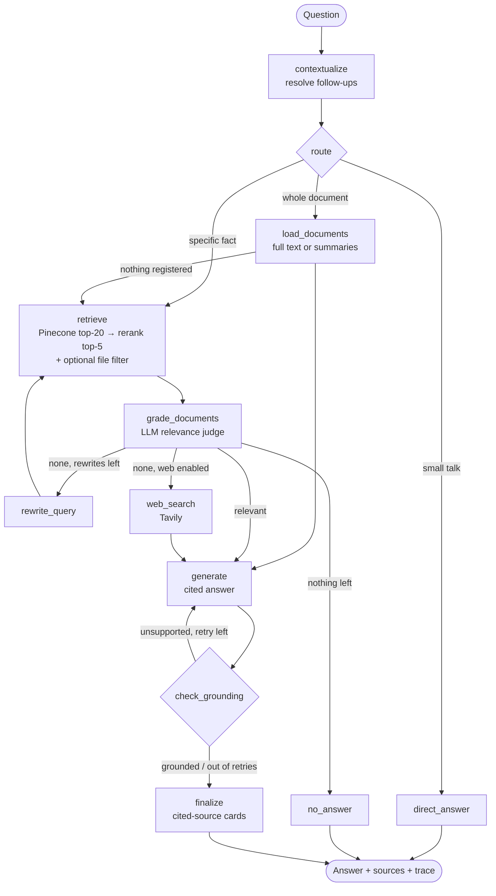

# 🧭 DocuPilot — Agentic RAG for Document Q&A

[](#testing--evaluation)


DocuPilot answers questions about your documents (company policies, course material,
assignments, manuals) **with citations**. It handles both *specific* questions ("what's the
hotel limit in Mumbai?") and *whole-document* questions ("how many questions are in this
assignment?"), and it **refuses instead of hallucinating** when the answer isn't there.

It is built with **Pinecone** (vector database + hosted reranker) and **LangGraph**
(agent workflow), and combines three published RAG patterns in a single graph:

| Pattern | What it does here |
|---|---|
| **Adaptive RAG** (3-way routing) | `retrieve` for specific facts, `document` for whole-document questions (summaries, counts, overviews), `direct` for small talk |
| **Corrective RAG** | An LLM grader drops irrelevant chunks → if nothing useful is left the query is rewritten and retried → optional web fallback |
| **Self-RAG** | A verifier checks every claim against the sources; unsupported answers are regenerated with stricter instructions, then flagged if still unverified |
| **Two-stage retrieval** | Dense search for 20 candidates → Pinecone cross-encoder reranker (`bge-reranker-v2-m3`) → best 5 |
| **Metadata filtering** | "Search only in" specific files via Pinecone filters |
| **Conversation memory** | Follow-ups ("and for fathers?") are rewritten into standalone questions; chats persist in SQLite |

## Features

- 📄 **Ingest PDF / Markdown / text** from the UI or CLI. Re-ingesting a file replaces its old vectors instead of duplicating them.
- 🧠 **LLM summary per document** at ingest time, shown in the sidebar and used by the router.
- 🔍 **Detects scanned PDFs** (no selectable text) and warns about image-only pages.
- 📚 **Citations** `[1]`. Sources the answer actually cites are shown first; the others are listed as "also retrieved".
- ✅ **Verification badge** for answers that passed the grounding check.
- 🔎 **Live agent trace** showing every decision the graph made.
- 🗂 **Document manager**: list, inspect and delete documents. Namespaces keep separate collections apart.
- 💬 **Saved conversations** (SQLite checkpointer). Reopen or delete past chats; export as Markdown.
- 👍👎 **Feedback** logged to `storage/feedback.jsonl`, which can be reused as new eval cases.
- 🛡 **Robustness**: automatic retry with backoff on rate limits, friendly error messages (no raw tracebacks), input validation, prompt-injection guard.
- 🔌 **Provider-agnostic**: Gemini (free tier) or OpenAI, picked automatically from your keys; the chat model can be switched in the sidebar.

## Architecture



**Ingestion pipeline:** load → validate (scanned/empty detection) → clean (whitespace,
hyphenation) → chunk with `RecursiveCharacterTextSplitter` (heading-aware separators,
section titles carried forward) → embed → upsert to a serverless Pinecone index with metadata
(`source`, `page`, `section`, `chunk`) → summarise → save full text + summary in the local
document registry.

```
docupilot/
├── app.py                    # Streamlit UI
├── docupilot/
│   ├── graph.py              # the LangGraph workflow + DocuPilot API (the core)
│   ├── ingest.py             # load → validate → chunk → embed → upsert → summarise
│   ├── vectorstore.py        # Pinecone index, filtered retrieval, reranking, stats
│   ├── registry.py           # per-document summaries + full text for whole-document mode
│   ├── chats.py              # persistent conversations + feedback log
│   ├── errors.py             # retry policy + user-friendly error messages
│   ├── prompts.py            # every prompt in one place
│   ├── schemas.py            # structured outputs (router, grader, verifier…)
│   ├── config.py             # settings from .env, provider auto-detection
│   ├── llm.py · web.py · cli.py
├── data/sample/              # demo handbook for a fictional company (Northwind Labs)
├── eval/                     # 29-question eval set + harness → JSON/Markdown reports
├── tests/                    # 39 offline tests (no API keys needed)
├── Dockerfile · .github/workflows/tests.yml
```

## Quick start

```bash
python -m venv .venv && .venv\Scripts\activate          # macOS/Linux: source .venv/bin/activate
pip install -r requirements.txt
copy .env.example .env                                  # macOS/Linux: cp .env.example .env
# edit .env: PINECONE_API_KEY and GOOGLE_API_KEY (free) or OPENAI_API_KEY

python -m docupilot.cli ingest data/sample              # creates the index, loads the demo handbook
streamlit run app.py                                    # http://localhost:8501
```

> **Upgrading from v1?** Re-run the ingest command once. v2 stores summaries and full text
> locally, which whole-document questions and the document list need.

### CLI

```bash
python -m docupilot.cli ask "What's the hotel limit in Mumbai?" --trace
python -m docupilot.cli ask "How many questions are there?" --source assignment.pdf --namespace assignment
python -m docupilot.cli chat
python -m docupilot.cli docs                 # list documents
python -m docupilot.cli delete leave_policy.md
python -m docupilot.cli stats
python -m docupilot.cli graph                # Mermaid diagram of the compiled graph
```

### Example (illustrative)

```
you › How many days of earned leave do I get?
Every full-time employee earns 18 days of earned leave per leave year, credited at 1.5 days per month [1].
Sources: [1] leave_policy.md · § 3.1 Earned leave (EL)   (relevance 0.97)

you › can I carry them over?            ← follow-up resolved using memory
Yes. Up to 30 days of unused earned leave can be carried forward; anything above 30 lapses on 31 December [1].

you › List every type of leave in the policy.          ← routed to whole-document mode
Earned, casual, sick, parental (maternity/paternity/adoption), bereavement, plus public holidays [1].

you › What is our stock option vesting schedule?      ← not in the documents
I couldn't find this in the knowledge base. …
```

## Testing & evaluation

```bash
pytest -q                          # 39 offline tests, ~4 s, no keys needed
python eval/run_eval.py --delay 4  # live evaluation against your index
```

> The eval set has 29 questions: 18 over the sample handbook (including out-of-scope questions), 8 over the Unit 5 course slides
> (`Unit_5_Classification.pdf`) and 3 over the Unit 1 slides (`Unit-1.pdf`). The course PDFs are not redistributed here; to reproduce
> all questions, ingest them into the same namespace first: `python -m docupilot.cli ingest path/to/Unit_5_Classification.pdf path/to/Unit-1.pdf`.

The offline tests cover every graph branch (routing, rewrite loop, web fallback, grounding
retry, whole-document mode, file filtering, citations, memory), plus retry and error handling,
input validation, scanned-PDF detection, the registry, and chat persistence across restarts.
CI runs them on Python 3.11–3.13 for every push.

The eval harness reports **retrieval hit rate, answer accuracy, routing accuracy, grounded rate,
refusal accuracy, and mean/p95 latency**, and saves `eval/results/<timestamp>.md` to paste into a report.
Use it to compare settings, e.g. `RERANK=false` vs `true`, or different `CHUNK_SIZE`/`TOP_K` values.

## Deployment

- **Streamlit Community Cloud** (free): push to GitHub → share.streamlit.io → New app → `app.py`, then add the `.env` values under *Secrets*.
- **Docker:** `docker build -t docupilot . && docker run -p 8501:8501 --env-file .env docupilot`
- **Tracing:** set `LANGSMITH_TRACING=true` and `LANGSMITH_API_KEY` to see every graph run in LangSmith.

## Running on a free tier

Free Gemini tiers can be as low as ~20 requests per day per model. DocuPilot keeps usage down:
- **Keyword routing**: "summarize…", "how many…", "hi" skip the router LLM call.
- **Whole-document answers** cost a single call (verification is skipped there by default).
- **Specific questions** cost 3–4 calls (route, grade, answer, verify). Set `VERIFY_ANSWERS=false` to save one.
- Point `GRADER_MODEL` at a cheaper model with a higher quota; check your limits at aistudio.google.com/rate-limit.
- Quota errors are reported precisely: per-minute limits are retried automatically; daily limits show when they reset.

## Configuration

All settings live in `.env` (see `.env.example`). The ones that matter most:

| Variable | Default | Purpose |
|---|---|---|
| `LLM_MODEL` / `GRADER_MODEL` | Gemini 3.8 Flash or GPT-4.1 mini | answer model / judge model (the judge can be cheaper) |
| `EMBEDDING_MODEL` | `gemini-embedding-001` or `text-embedding-3-small` | change ⇒ use a new `PINECONE_INDEX` |
| `FETCH_K` / `TOP_K` | 20 / 5 | candidates retrieved / kept after reranking |
| `RERANK` | true | Pinecone hosted reranker; falls back to vector order if unavailable |
| `MAX_REWRITES` | 2 | corrective-RAG retries before giving up |
| `FULL_DOC_CHAR_LIMIT` | 300 000 | above this, whole-document mode uses summaries + excerpts |

## Limitations & future work

- Scanned PDFs need OCR (currently detected and rejected with a clear message).
- Whole-document mode is bounded by the model's context window. Very large collections fall back to summaries.
- Possible next steps: hybrid sparse+dense search for exact codes, table extraction, token streaming, user authentication and per-user namespaces.
